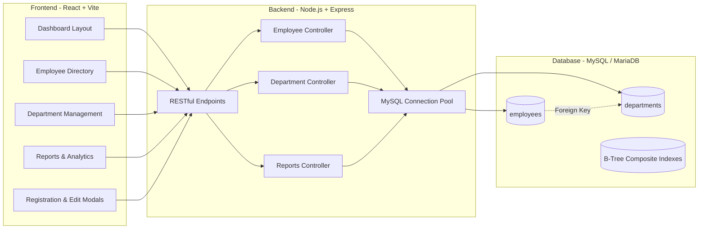

# XCELTECH Employee Management System (EMS)

An enterprise-grade **Employee Management System** built with **React**, **Node.js (Express)**, and **MySQL (MariaDB)**, featuring the exact UI layout, color palette, and component structure adapted from the reference dashboard.

---

## 🎨 UI Architecture & Color Palette

The interface adheres faithfully to the reference design:
- **Sidebar**: Fixed dark navy background (`#0e172e`), circular avatar ring with amber-yellow accent (`#fdb827`), navigation badges, red power button (`#ea2b2b`), and geometric bottom motif.
- **Top Header**: Modern hamburger menu, integrated search combo with navy department dropdown (`#1c326d`), and circular badge icons (Navy Bell, Yellow Wrench, Green Mail).
- **Action Tabs**: Rounded pills with active highlight in vibrant yellow (`#fdb827`) and dark navy inactive tabs (`#1c326d`).
- **Main Container**: Rounded white card (`border-radius: 24px`), soft shadow, green Export button (`#328332`), and soft blue table header strip (`#dbe7f6`).
- **Row Actions**: Navy blue rounded pill button (`#1c326d`) with interactive dropdown popover (View Details, Edit, Delete).

---

## 🏗️ System Architecture & Tech Stack



---

## ⚡ Performance Optimizations Implemented

1. **Database Indexing**:
   - `INDEX idx_emp_search (first_name, last_name, employee_id)` for sub-millisecond full-text prefix searches.
   - `INDEX idx_emp_dept (department_id)` for instant foreign key joins.
   - `INDEX idx_emp_status (status)` and `INDEX idx_emp_hire_date (hire_date)` for filtered queries and sorting.
2. **Server Connection Pooling**:
   - `mysql2/promise` with configurable pool size (`connectionLimit: 15`), keep-alive checks, and automatic connection recycling.
3. **Optimized Paginated Queries**:
   - SQL `LIMIT ? OFFSET ?` queries combined with indexed counts prevents fetching unnecessary memory buffers.
4. **Vite Reverse Proxy**:
   - Frontend proxies `/api` directly to backend on `http://localhost:5000`, eliminating CORS preflight overhead in development and simplifying staging.

---

## 🚀 Quickstart & Setup Guide

### 1. Database Initialization
Make sure MySQL is active (XAMPP or standalone service on port 3306). Then run:
```bash
cd backend
npm run db:init
```
*This automatically creates `employee_management_db`, tables, foreign keys, indexes, and seeds 6 departments and 14 personnel.*

### 2. Start Backend Server
```bash
cd backend
npm start
```
*API runs at `http://localhost:5000` (Health check: `http://localhost:5000/api/health`).*

### 3. Start Frontend Client
```bash
cd frontend
npm run dev
```
*Access the dashboard at `http://localhost:3000`.*

